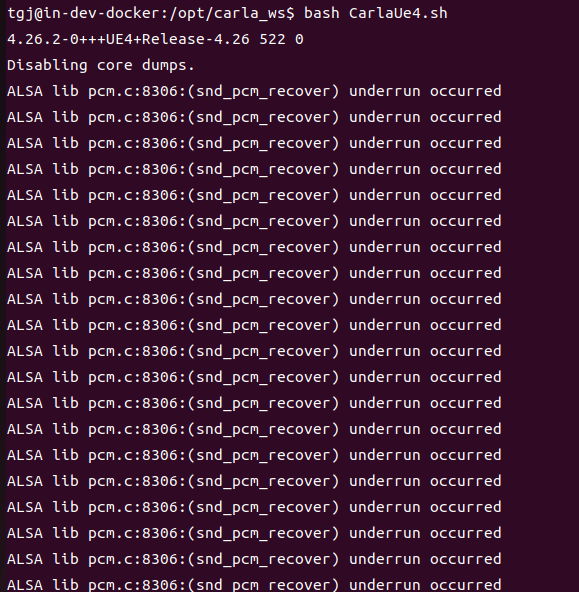
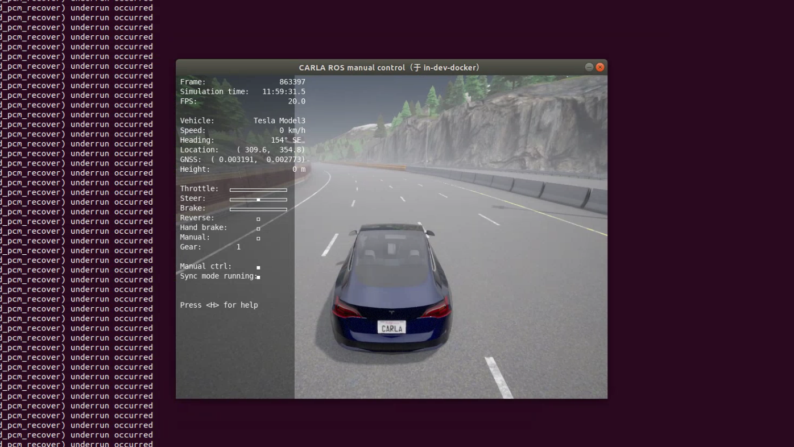
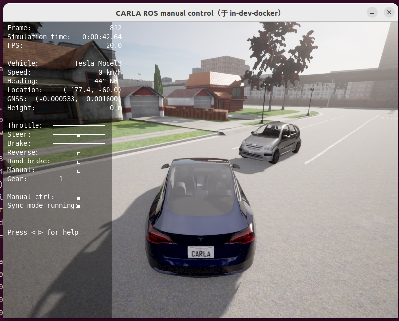
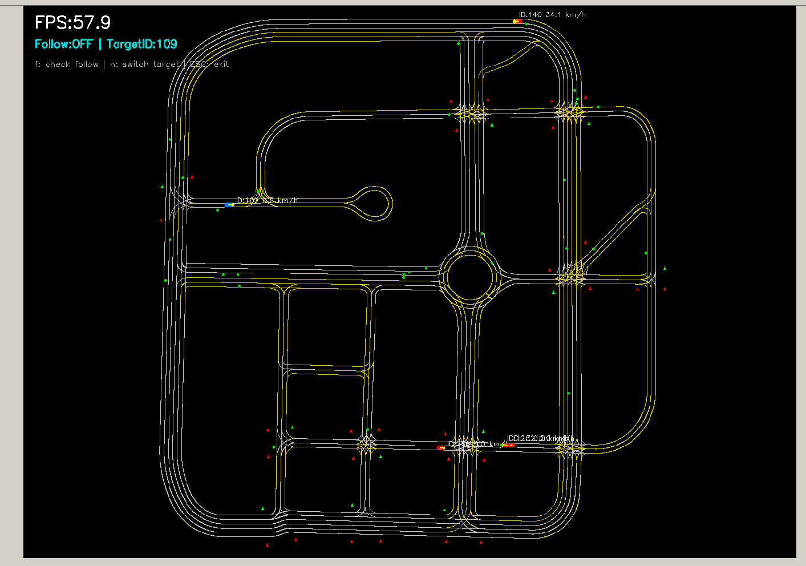

# 11_仿真环境的上帝视角可视化
# 1 启动容器

1. 启动容器
```
cd carla_sim
bash docker/scripts/dev_start.sh
```
2. 进入镜像
```
bash docker/scripts/dev_into.sh
```

# 2 启动Carla UE4

```
cd /opt/carla_ws
bash ./CarlaUe4.sh
```


# 3 启动ros bridge car
新开一个终端
```
cd carla_sim
bash ros_bridge.sh
```



# 4 创建NPC
新开一个终端
```
python scripts/spawn_random_npc_py2.py _vehicle_count:=20 _walker_count:=10 #自定义添加数量
```


# 5 启动上帝视角可视化
这个地图是Carla仿真环境中自带的Opendrive地图,只是拿来读取并解析可视化出来，然后再把NPC的位置画到图中。
新开一个终端
```
cd /opt/carla_ws/sim_workspace/sim_view
python sim_view_py2.py
```
主要功能：
1.默认地图启动跟随ego vehicle进行运动，f键切换跟随开关，n键切换跟随的ID
2.单击可拖动地图,滚动进行缩放
3.实时查看所有NPC的位置和运动速度
4.蓝色方块是ego vehicle的位置,红色方块是NPC的车辆位置，绿色方块是NPC的人位置
5.三角形是交通灯的位置，颜色是交通灯的状态（红/绿/黄）

