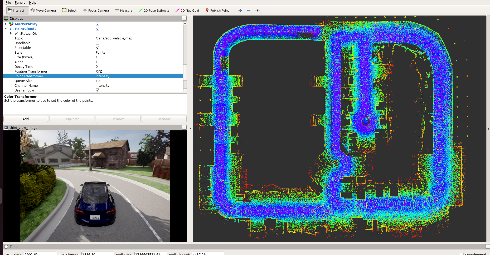
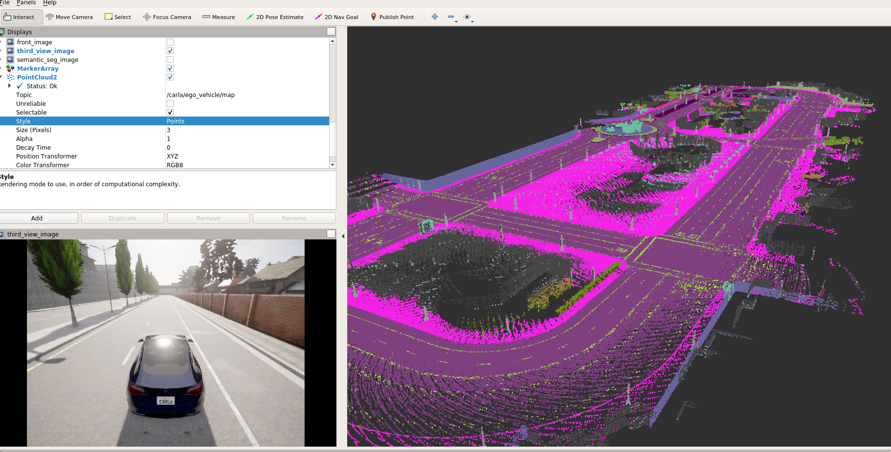
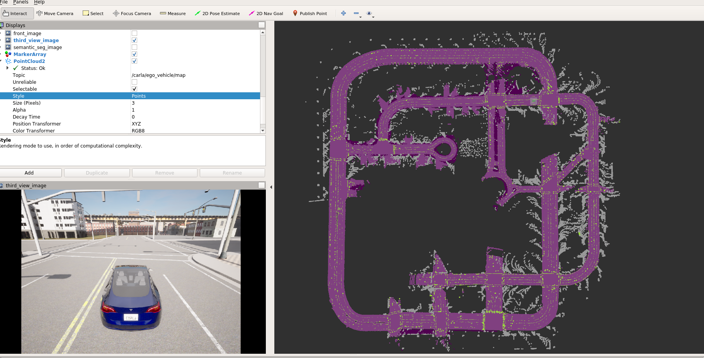

# 12_构建仿真环境的点云地图
# 1 启动容器

1. 启动容器
```
cd carla_sim
bash dev_start.sh
```
2. 进入镜像
```
bash dev_into.sh
```

# 2 启动Carla UE4

```
cd /opt/carla_ws
bash ./CarlaUe4.sh
```


# 3 启动ros bridge car
新开一个终端
```
cd carla_sim
bash ros_bridge.sh
```


# 5 启动建图程序
采用c++实现的建图程序，基本原理：主要用到激光雷达的点云数据、前视相机语义分割数据和Gps数据，通过点云到相机的投影获取点云的语义信息，再转换到Gps坐标系下得到世界坐标系下的点云地图。

新开一个终端
```
cd /opt/carla_ws/sim_workspace/pointcloud_map/build
pointcloud_map 0 1
```
**参数1：**
    0：纯激光点云的地图
    1：激光点云+语义分割的地图
    2：激光点云+道路、地面、灯杆的地图
**参数2：** 
    激光雷达间隔帧数，值为1即每帧激光雷达数据进行一次建图

# 6 启动rviz可视化
新开一个终端
```
cd /opt/carla_ws
rosrun rviz rviz -d carla_sim_config.rviz
```

# 7 建图效果
开启ego_vehicle的自动驾驶模式，开始自动建图，整个建图效果如下：

**0-纯激光点云的地图**


**1-激光点云+语义分割的地图**


**2-激光点云+道路、地面、灯杆的地图**

