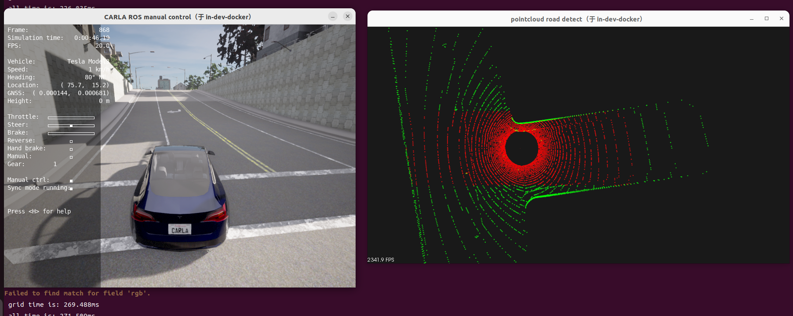
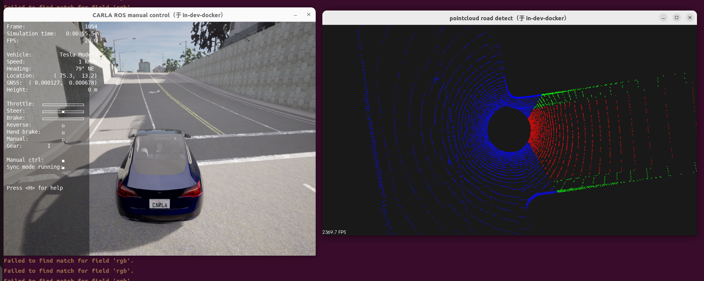
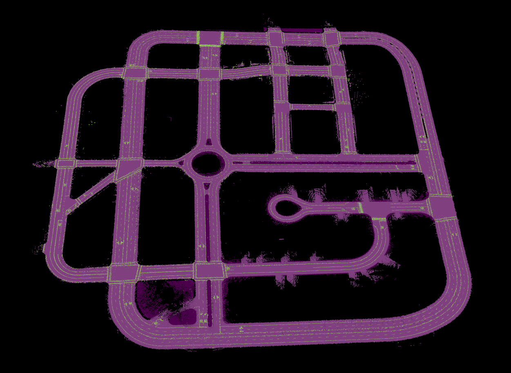
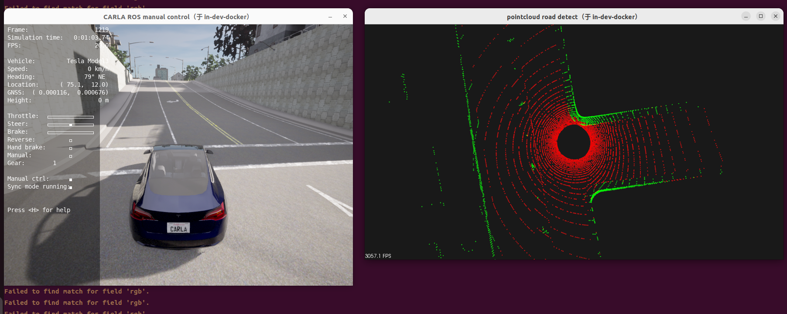

# 13_点云地面提取
# 1 启动容器

1. 启动容器
```
cd carla_sim
bash dev_start.sh
```
2. 进入镜像
```
bash dev_into.sh
```

# 2 启动Carla UE4

```
cd /opt/carla_ws
bash ./CarlaUe4.sh
```


# 3 启动ros bridge car
新开一个终端
```
cd carla_sim
bash ros_bridge.sh
```


# 5 地面提取方法
目前的方法大概可以分：基于几何规则、拟合方法、深度学习的方法。
**基于几何规则：**
主要就是网格法，将点云划分成多个网格，统计每个网格内点云的数量，高度最大值和最小值等，综合判断是否是地面。

**拟合方法：**
1.采用ransac进行平面拟合，通过拟合的平面来判断地面；
2.采用分段拟合的方法，这样可以适应坡道的场景。

**深度学习的方法：**
1.使用深度学习模型来提取地面，如PointNet++；
2.点云转为距离图像（Range Image），用2D卷积网络做语义分割，如SqueezeSeg；
3.通过图像的语义分割结果，再加上点云投影到图像的位置，判断哪些点是地面，哪些点不是地面。

# 6 结果展示

新开一个终端
```
cd /opt/carla_ws/sim_workspace/ground_segmention/build
./ground_segmention 0/1
./ground_segmention 2 ./../../pointcloud_map/map/points_map_marker.pcd
参数：
0：基于几何规则的地面提取方法
1：基于图像语义分割的地面提取方法
2：基于先验地图+ransac迭代的地面提取方法
```

**0-基于几何规则的地面提取方法**
这里考虑性能，只是在一个ROI的区域做地面分割，而不是整个点云。


**1-基于图像语义分割的地面提取方法**
这里考虑carla的性能问题，只是展示利用前视相机的语义分割结果进行地面分割效果。


**2-基于先验点云地图+ransac迭代的地面提取方法**
先验地面点云地图


ransac迭代后的地面点云分割效果
