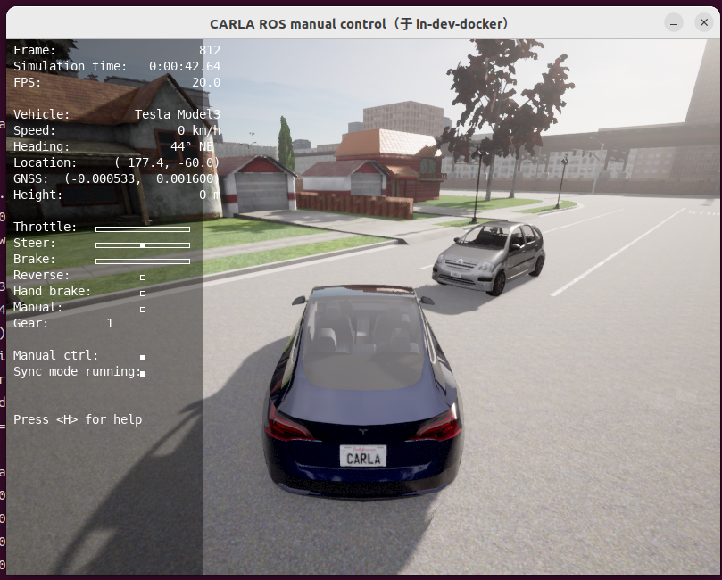
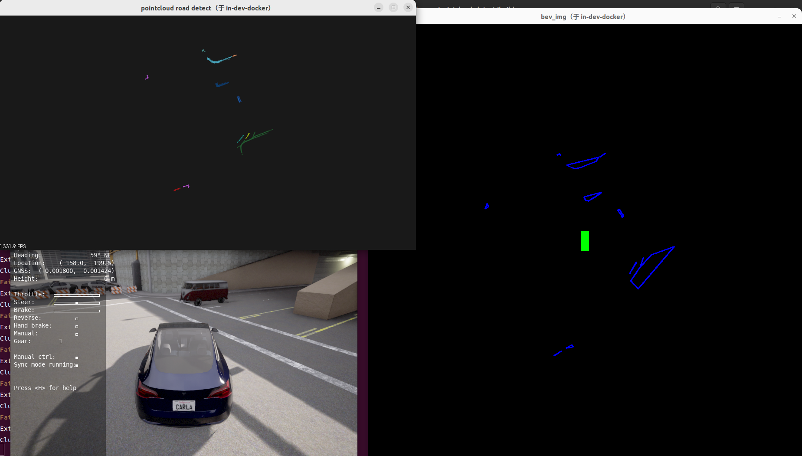

# 14_点云的障碍物检测
# 1 启动容器

1. 启动容器
```
cd carla_sim
bash dev_start.sh
```
2. 进入镜像
```
bash dev_into.sh
```

# 2 启动Carla UE4

```
cd /opt/carla_ws
bash ./CarlaUe4.sh
```


# 3 启动ros bridge car
新开一个终端
```
cd carla_sim
bash ros_bridge.sh
```


# 4 创建NPC
新开一个终端
```
python scripts/spawn_random_npc_py2.py _vehicle_count:=20 _walker_count:=10 #自定义添加数量
```


# 5 障碍物检测
点云障碍物的检测方法，大概可以分为：点云聚类的方法、点云检测的方法、图像检测+点云的方法。

## 5.1 点云聚类的方法
**核心思路**：先地面点去除，对剩余非地面点，依据空间距离、密度做聚类，每一个簇视为一个障碍物；输出障碍物包围盒，**本身不做类别识别**（不知道是车 / 人 / 石头）。

- 代表算法：欧氏聚类、DBSCAN、网格聚类
- 流程：点云预处理（滤波降采样）→地面分割剔除地面点→聚类分割障碍物簇→计算 3D 包围盒

**优点：**
- 无需训练、不需要标注数据集；
- 对**未知障碍物、异形障碍物**友好，什么物体都能检出；
- 算力开销低，适合嵌入式、简单机器人。

**缺点：**
- 只知道 “这里有障碍物”，**不能区分障碍物类别**；
- 参数敏感，距离远、点云稀疏、物体粘连时容易过分割 / 欠分割；
- 雨雪噪点容易产生大量误检。

## 5.2 点云检测的方法
**核心思路**：仅输入激光雷达点云，通过网络学习几何特征，直接输出障碍物 3D 框、类别、尺寸、朝向、速度，不需要图像输入。
细分三类实现范式：
- 基于原始点：PointNet、PointNet++；直接处理无序点
- 基于体素 / 稀疏卷积：VoxelNet、SECOND；把点云切成 3D 格子
- 柱体 / BEV 鸟瞰图：PointPillars、CenterPoint，工程落地最多

**优点：**
- 依靠几何信息，**不受光照、黑夜影响**；输出精准 3D 位置、尺寸；
- 可以直接输出障碍物类别（车、行人、骑行者）；
- 不需要依赖相机标定、图像数据。

**缺点：**
- 需要大量 3D 标注数据集；对小物体、点云很稀疏的远距离目标效果下降；
- 没有颜色纹理信息，外观相似物体容易混淆。

## 5.3 图像检测+点云的方法
**核心思路**：相机图像提供纹理、颜色、类别语义；点云提供精准三维距离几何信息；两者融合，取长补短。
按融合时机分为 3 种：
- **前融合（数据层）**：图像像素特征投影赋值到点，带颜色语义的点云送入 3D 网络；
- **特征融合（中间层）**：分别提取图像、点云特征，网络内部做特征交互（BEVFormer、TransFusion）；
- **后融合（决策层）**：图像 2D 检测器、点云 3D 检测器各自输出结果，再做结果匹配融合。

**优点：**
- 结合图像的语义纹理 + 点云的几何测距；夜间靠点云兜底，白天图像提升分类；
- 小目标、遮挡场景，检测与分类精度高于纯点云方案。

**缺点:**
- 强依赖**相机‑激光雷达外参标定**，标定漂移性能会暴跌；
- 计算量大；图像受逆光、强光、雨雪影响，图像失效会拖累整体。

# 6 结果展示
这里只实现了基于点云聚类的方法进行障碍物的检测。
新开一个终端
```
cd /opt/carla_ws/sim_workspace/pointcloud_detect/build
./pointcloud_detect 2 ./../../pointcloud_map/map/points_map_marker.pcd
```
下图主要实现的是点云的聚类方法，输出障碍物多边形包围盒，没有类别信息，绿色矩形表示自车。

