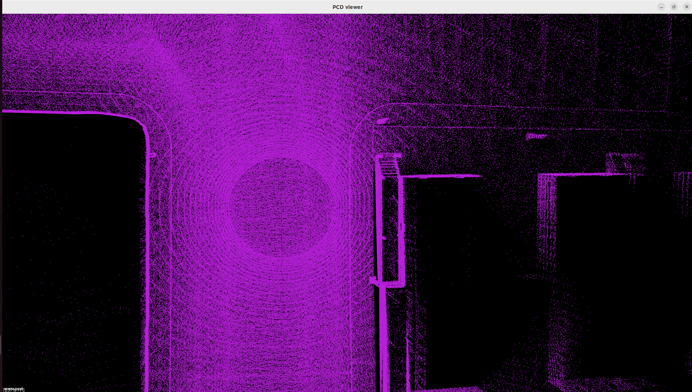
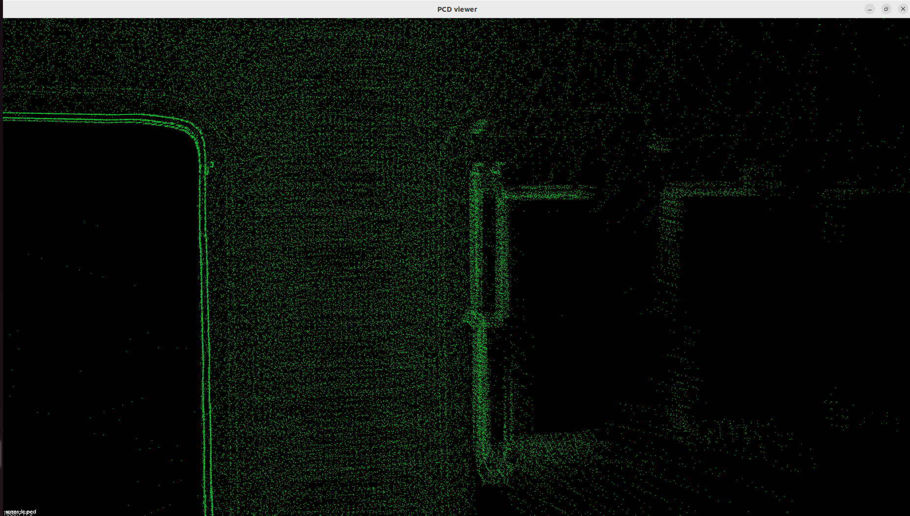

# 15_将Carla传感器数据接入Fast_LIO2+SC_PGO建图
# 1 启动容器

1. 启动容器
```
cd carla_sim
bash dev_start.sh
```
2. 进入镜像
```
bash dev_into.sh
```

# 2 启动Carla UE4

```
cd /opt/carla_ws
bash ./CarlaUe4.sh
```


# 3 启动ros bridge car
新开一个终端
```
cd carla_sim
bash ros_bridge.sh
```


# 4 fast_lio2+sc_pgo建图
## 4.1 fast_lio2

**LiDAR+IMU 紧耦合激光惯性里程计**，输出高频实时位姿与局部地图。

- 框架：**IESKF 迭代误差状态卡尔曼滤波**，IMU 做状态预测、对点云做运动畸变校正
- 核心创新：**不提取边缘 / 平面特征，直接原始点云 scan-to-map 配准**；用`ikd-Tree`增量地图，支持动态增删点，速度快，适配固态雷达 Livox、机械雷达都可以跑
- 短板：滤波器只做**局部最优**，长时间跑会**累积漂移**，走大环线回到起点时，轨迹闭合不上；**本身不带回环检测**

## 4.2 sc_pgo
**ScanContext 回环检测 + PGO 位姿图优化（后端）**
- **ScanContext（SC）**：激光全局描述子，拿一帧点云生成 2D 直方图，用来**回环检测**：判断当前位置是不是曾经来过的地方；找到回环后，再用 ICP/GICP 计算两关键帧之间相对位姿约束
- **PGO（Pose Graph Optimization，位姿图优化）**
把 FAST-LIO2 输出的关键帧作为图节点；相邻帧的里程计结果作为相邻约束；ScanContext 找到的回环作为回环约束；整体最小化所有约束误差，**全局一次性修正整条轨迹，消除漂移**，重建全局一致点云地图。

# 5 启动建图
新开一个终端
```
cd carla_sim/sim_workspace/slam/lio_slam/
catkin_make #编译
source devel/setup.bash #source环境变量

roslaunch fast_lio mapping_carla_norviz.launch #启动前端
```

新开一个终端
```
roslaunch sc_pgo sc_pgo_carla.launch #启动后端
```

# 6 效果展示
下图是前端fastlio2建的地图


下图是前端fastlio2+后端sc_pgo建的地图


从上面看引入后端优化后怎体效果还变差了，可能是由于后端优化的参数设置问题，导致地图的精度下降。在真实场景前端由于误差的累积，肯定是没有带后端优化那么准确的，还有后端优化的回环检测的方法也是很关键的。