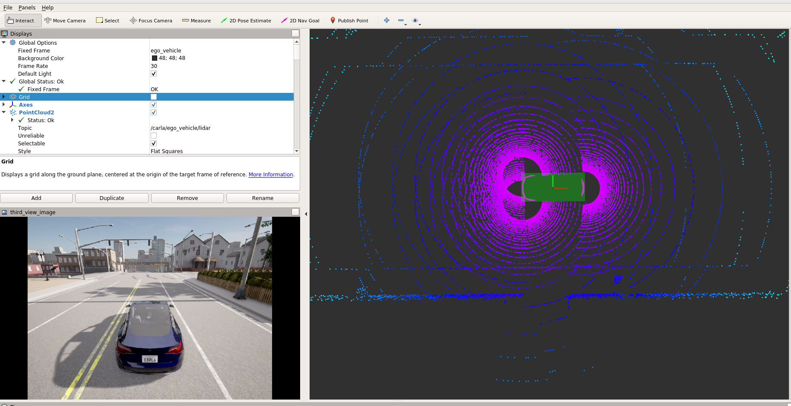
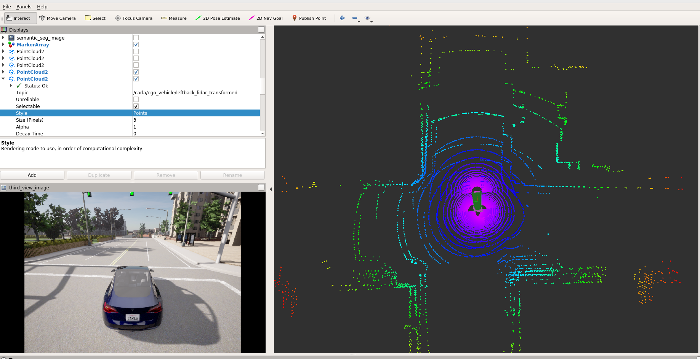
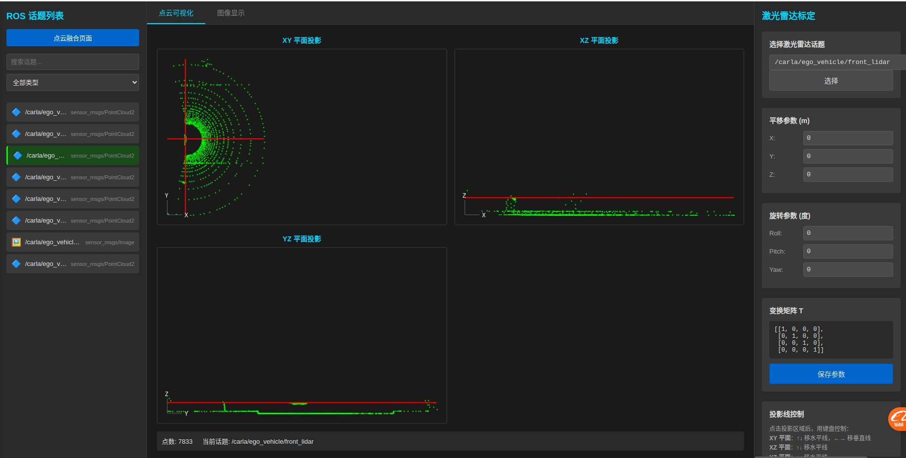
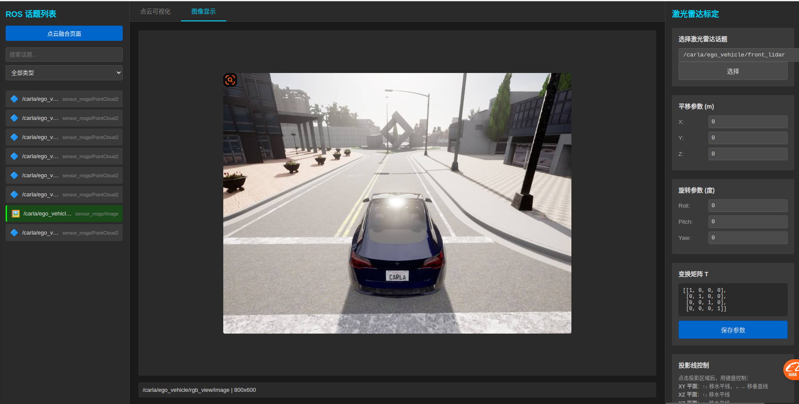
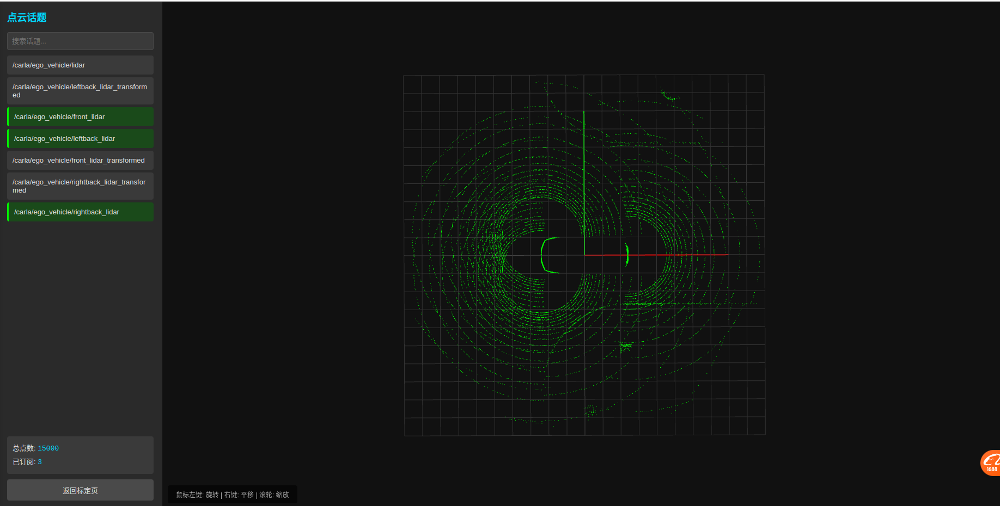

# 16_多Lidar传感器的标定
# 1 启动容器

1. 启动容器
```
cd carla_sim
bash dev_start.sh
```
2. 进入镜像
```
bash dev_into.sh
```

# 2 启动Carla UE4

```
cd /opt/carla_ws
bash ./CarlaUe4.sh
```


# 3 添加传感器
修改objects.json文件，添加front_lidar、leftback_lidar和rightback_lidar传感器
```
{
    "type": "sensor.lidar.ray_cast",
    "id": "front_lidar",
    "spawn_point": {"x": 2.39, "y": 0.0, "z": 0.68, "roll": 0.0, "pitch": 0.0, "yaw": 0.0},
    "range": 50,
    "channels": 32,
    "points_per_second": 320000,
    "upper_fov": 2.0,
    "lower_fov": -26.8,
    "rotation_frequency": 20,
    "noise_stddev": 0.0
},
{
    "type": "sensor.lidar.ray_cast",
    "id": "leftback_lidar",
    "spawn_point": {"x": -2.39, "y": 0.92, "z": 0.8, "roll": 0.0, "pitch": 0.0, "yaw": 0.0},
    "range": 50,
    "channels": 32,
    "points_per_second": 320000,
    "upper_fov": 2.0,
    "lower_fov": -26.8,
    "rotation_frequency": 20,
    "noise_stddev": 0.0
},
{
    "type": "sensor.lidar.ray_cast",
    "id": "rightback_lidar",
    "spawn_point": {"x": -2.39, "y": -0.92, "z": 0.8, "roll": 0.0, "pitch": 0.0, "yaw": 0.0},
    "range": 50,
    "channels": 32,
    "points_per_second": 320000,
    "upper_fov": 2.0,
    "lower_fov": -26.8,
    "rotation_frequency": 20,
    "noise_stddev": 0.0
},
```

# 4 启动ros bridge car
新开一个终端
```
cd carla_sim
bash ros_bridge.sh
```
下图就是添加好的传感器，可以看到每个传感器的点云，构成围绕车身的环视点云。


# 5 模拟传感器安装误差
通过订阅正常的点云，然后再通过脚本引入传感器安装误差。
新开一个终端
```
cd sim_workspace/multisensor_calib/
python lidar_transform_py2.py

修改lidar_transform_py2.py文件，引入传感器安装误差。
# ========= 配置参数 =========
# 每个激光雷达的外参（平移 + 旋转）
# 平移单位：米，旋转单位：度
LIDAR_CONFIG = {
    'front_lidar': {
        'topic_in': '/carla/ego_vehicle/front_lidar',
        'topic_out': '/carla/ego_vehicle/front_lidar_transformed',
        'translation': [0.0, 0.0, 0.0],  # x, y, z
        'rotation': [0.0, 3.0, 0.0]      # roll, pitch, yaw (角度)
    },
    'leftback_lidar': {
        'topic_in': '/carla/ego_vehicle/leftback_lidar',
        'topic_out': '/carla/ego_vehicle/leftback_lidar_transformed',
        'translation': [0.2, 0.0, 0.0],
        'rotation': [0.0, 0.0, 3.0]
    },
    'rightback_lidar': {
        'topic_in': '/carla/ego_vehicle/rightback_lidar',
        'topic_out': '/carla/ego_vehicle/rightback_lidar_transformed',
        'translation': [0.0, 0.1, 0.0],
        'rotation': [2.0, 0.0, 0.0]
    }
}
```



# 6 传感器标定
参考：https://github.com/PJLab-ADG/SensorsCalibration
这里只是介绍一种简单的手动标定的方法，实际应用中需要根据具体场景和需求选择合适的标定方法。
```
cd sim_workspace/multisensor_calib
python server.py
```
功能：
1.图像的可视化
2.通过话题显示每个传感器的点云
3.手动标定每个传感器的外参
4.合并所有传感器的外参，得到最终的传感器标定结果

**lidar的标定可视化**

**图像的可视化**

**多lidar的合并可视化**
