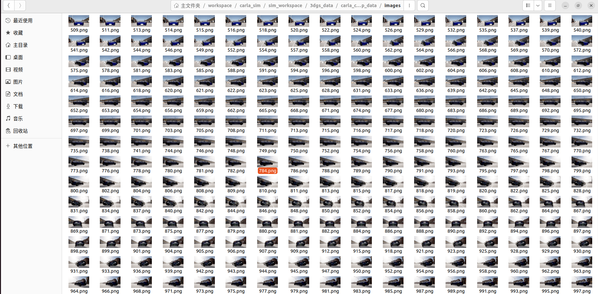
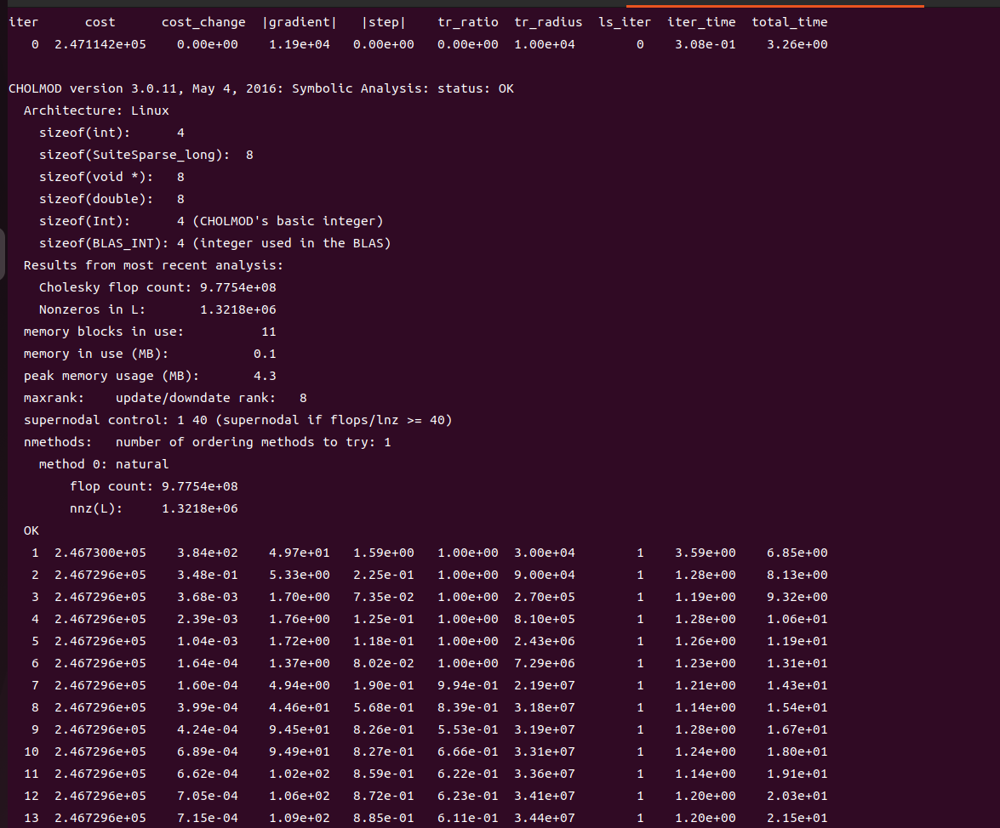
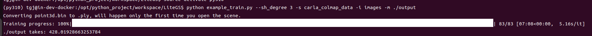
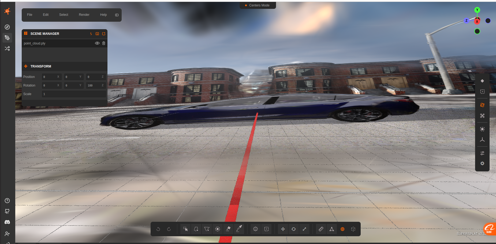
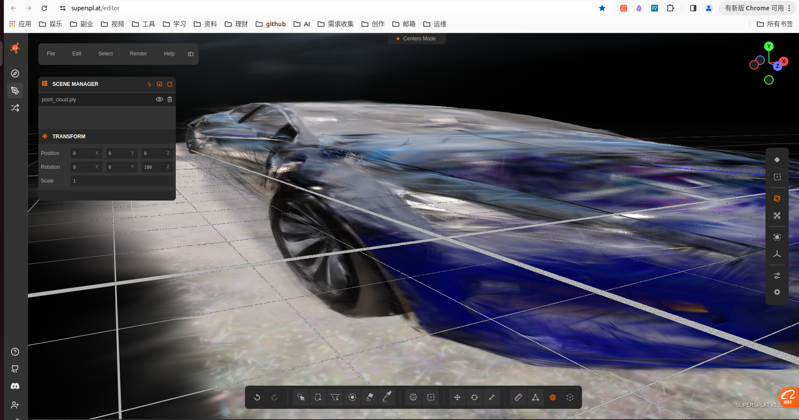

# 17_利用Carla场景跑通3DGS建模
# 1 启动容器

1. 启动容器
```
cd carla_sim
bash dev_start.sh
```
2. 进入镜像
```
bash dev_into.sh
```

# 2 启动Carla UE4

```
cd /opt/carla_ws
bash ./CarlaUe4.sh
```


# 3 启动ros bridge car
新开一个终端
```
cd carla_sim
bash ros_bridge.sh
```


# 4 采集车辆图像数据
这里使用自车作为采集对象，采集了360张720P的图像，实际就是围绕车的几何中心360度，每隔1度采集一张图像。
新开一个终端
```
cd carla_sim/sim_workspace/slam/3dgs_data/
python surround_collect_gs_py2.py
```


# 5 colmap预处理
我这里是用apt直接安装的colmap，所以预处理在CPU上跑的，速度比较慢，如果要在GPU上跑需要自己下载源码编译GPU版本的colmap。
新开一个终端
```
cd carla_sim/sim_workspace/slam/3dgs_data/
bash colmap_3dgs.sh
```



# 6 LiteGS训练

LiteGS源码下载地址：[LiteGS](https://github.com/MooreThreads/LiteGS.git)
这个环境需要自己搭建，不在carla项目里面，也很简单照着文档搭建就行。

新开一个终端
```
python example_train.py --sh_degree 3 -s carla_colmap_data -i images -m ./output

参数：
carla_colmap_data：是colmap预处理后的数据，包含360张图像、相机参数和3D点云bin文件。
images：是carla_colmap_data中的图像文件夹名称，包含360张图像。
output：是训练输出的点云的目录，ply格式。
```


# 7 效果展示
下图是采用在线网站导入ply文件后直接展示的效果。
https://superspl.at/editor



下图是放大的能够看见很多尖刺，这个就是高斯球。
```
每个高斯保存一组参数：
xyz：3D 空间中心坐标
scale：3 个方向尺度（log 空间，控制椭球大小）
rot(四元数)：椭球旋转
opacity：不透明度
f_dc + f_rest（SH球谐系数）：颜色，SH 可以随观察角度改变颜色，实现照片级光影。
```


从整体效果还是可以，但有些角度不是很好，还有我这个相机设置的高度太低了，并且只在一个平面上运动，最好能够上下俯仰移动，这样能够看到更多的场景。